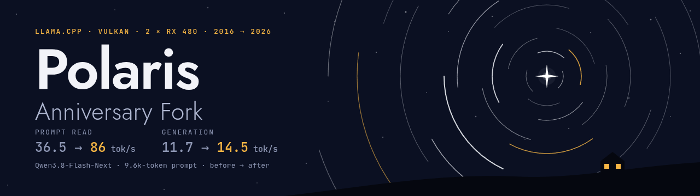

# llama.cpp — Polaris Anniversary Fork



> **The Polaris Anniversary Fork.** The AMD Radeon RX 480 came out in June 2016. Ten years on, this fork of llama.cpp
> keeps a home lab useful for today's large mixture-of-experts models, with the Vulkan backend and the experts in system
> memory. The lab started with two RX 480s (8 GB each, no fp16) and now also has a Radeon AI PRO R9700 (32 GB):
> - sparse-attention ops that used to fall back to the CPU on GPUs without fp16;
> - a GPU cache of the most used experts that runs beside the CPU, with the scheduler and Vulkan changes around it;
> - a small learned model that predicts which experts the next tokens need;
> - kernel tuning for RDNA4.
>
> With Qwen3.8-Flash-Next on the two RX 480s, a 9.6k-token prompt reads at 86 tok/s instead of 36.5, and generation runs
> at 14.5 tok/s instead of 11.7. On the R9700, the cache took generation from 16.8 to 25.9 tok/s with the same
> settings, and with the predictor and two MTP drafts it now runs at about 30. The results and how they were measured
> are in [FORK.md](FORK.md).
>
> **It is tuned for one home lab.** Some changes work around the RX 480's Vulkan driver and could make other GPUs slower
> where they collide with features that modern GPUs use. We try to avoid that: the changes that apply to every GPU were
> also tested on an NVIDIA RTX 4070 Ti, also with Vulkan. The fork isn't affiliated with ggml-org, and the changes haven't been submitted
> upstream.

## Branches

Each part is a branch of its own, on top of upstream llama.cpp, so it can be used without the rest. Several are
useful beyond Polaris.

| branch | what it has | for | guide |
|---|---|---|---|
| [`polaris`](https://github.com/Lanilen/llama.cpp/tree/polaris) | everything below, and this README | the lab's setup: the one to use | [FORK.md](FORK.md) |
| [`vk-sparse-attn`](https://github.com/Lanilen/llama.cpp/tree/vk-sparse-attn) | Vulkan support for the sparse-attention ops on GPUs without fp16 | any Vulkan GPU without fp16 (Polaris, older GCN) with Qwen3.8-Flash-Next or DeepSeek-style indexers | [docs/vk-sparse-attn.md](docs/vk-sparse-attn.md) |
| [`moe-hot-spare`](https://github.com/Lanilen/llama.cpp/tree/moe-hot-spare) | a GPU cache of the most used experts that runs beside the CPU; scheduler and Vulkan changes for models with experts on the CPU; trace tools | any MoE model whose experts don't fit in VRAM, on Vulkan GPUs (tested on AMD and NVIDIA) | [docs/moe-hot-spare.md](docs/moe-hot-spare.md) |
| [`moe-predictor`](https://github.com/Lanilen/llama.cpp/tree/moe-predictor) | `moe-hot-spare` plus a learned predictor of the next experts, and its training pipeline | the same; trained so far for Qwen3.8-Flash-Next | [docs/moe-predictor.md](docs/moe-predictor.md) |
| [`vk-rdna4`](https://github.com/Lanilen/llama.cpp/tree/vk-rdna4) | Vulkan matrix kernel tuning for RDNA4 (**work in progress, stable**) | AMD RDNA4 GPUs (RX 9060/9070, AI PRO R9700) | [docs/vk-rdna4.md](docs/vk-rdna4.md) |
| `master` | upstream, unchanged | | |

## Install this fork

The fork has no packages, installers or release binaries. Build it from source with the Vulkan backend (the Vulkan SDK
or your distribution's Vulkan headers and `glslc`, see [the Vulkan build guide](docs/build.md#vulkan)):

```bash
git clone -b polaris https://github.com/Lanilen/llama.cpp
cd llama.cpp
cmake -B build-vk -DGGML_VULKAN=ON -DCMAKE_BUILD_TYPE=Release
cmake --build build-vk -j
```

The programs are in `build-vk/bin`.

- **A newer `glslc`:** Ubuntu 24.04's (shaderc 2023.8) builds without the int8 dot product, bf16 and coopmat2 shaders,
  and doesn't say so. Point CMake at a newer one with `-DVulkan_GLSLC_EXECUTABLE=/path/to/glslc` (see
  [docs/vk-rdna4.md](docs/vk-rdna4.md#building-for-rdna4)).
- **ROCm beside Vulkan:** ROCm 6 and later fail to start when a GPU they don't support, such as Polaris (gfx803), is in
  the machine. [rocm-hide-gpus](https://github.com/Lanilen/rocm-hide-gpus), a separate repository, is a preload library
  that hides those GPUs from ROCm only. With it, one llama.cpp process can run the R9700 on ROCm and the RX 480s on
  Vulkan.

The setups used in the lab are in [FORK.md](FORK.md#setups).

---

*The rest of this README is upstream llama.cpp's.*


<div align="center">

<b>LLM inference in C/C++</b>

[](https://opensource.org/licenses/MIT)
[](https://github.com/ggml-org/llama.cpp/releases?q=tag:v0)
[](https://github.com/ggml-org/llama.cpp/releases?q=b)
[](https://github.com/ggml-org/llama.cpp/actions/workflows/server.yml)
[](https://github.com/ggml-org/llama.cpp/actions/workflows/docker.yml)
[](https://github.com/ggml-org/llama.cpp/actions/workflows/winget.yml)

[ggml](https://github.com/ggml-org/ggml) / [ops](https://github.com/ggml-org/llama.cpp/blob/master/docs/ops.md) / [maintainer PRs](https://github.com/ggml-org/llama.cpp/issues?q=is%3Apr%20is%3Aopen%20draft%3AFalse%20(author%3Asanmai%20OR%20author%3Argerganov%20OR%20author%3AKitaitiMakoto%20OR%20author%3Adanbev%20OR%20author%3Aaldehir%20OR%20author%3Amax-krasnyansky%20OR%20author%3ACISC%20OR%20author%3Aggerganov%20OR%20author%3Aam17an%20OR%20author%3Ajhen0409%20OR%20author%3Abartowski1182%20OR%20author%3Anikwen%20OR%20author%3Ahipudding%20OR%20author%3Aravi9%20OR%20author%3AServeurpersoCom%20OR%20author%3Athelittlefireman%20OR%20author%3Apwilkin%20OR%20author%3Areeselevine%20OR%20author%3Angxson%20OR%20author%3Ajeffbolznv%20OR%20author%3Amarty1885%20OR%20author%3A0cc4m%20OR%20author%3ATitaniumtown%20OR%20author%3Aangt%20OR%20author%3AIMbackK%20OR%20author%3Aarthw%20OR%20author%3AJohannesGaessler%20OR%20author%3AORippler%20OR%20author%3Aruixiang63%20OR%20author%3Axctan%20OR%20author%3AmasterFoad%20OR%20author%3Aallozaur%20OR%20author%3AAndreas-Krebbel%20OR%20author%3Ayomaytk%20OR%20author%3Aaendk%20OR%20author%3Awine99%20OR%20author%3Agaugarg-nv%20OR%20author%3Ataronaeo%20OR%20author%3Aforforever73%20OR%20author%3Achaxu01%20OR%20author%3Alhez%20OR%20author%3AAlekseiNikiforovIBM%20OR%20author%3Anetrunnereve%20OR%20author%3Afairydreaming%20OR%20author%3Aynankani)%20sort%3Aupdated-desc) / [dev stats](https://github.com/ggml-org/llama.cpp-dev) / [lib llama API](https://github.com/ggml-org/llama.cpp/issues/9289) / [llama-server REST API](https://github.com/ggml-org/llama.cpp/issues/9291)

</div>

## Quick start (regular llama.cpp)

> The installers, packages, Docker images and release binaries below install **regular llama.cpp from ggml-org, not this
> fork**. To use the fork, build it as in [Install this fork](#install-this-fork).

A few options to get `llama.cpp` installed on your machine:

```bash
# curl
curl -LsSf https://llama.app/install.sh | sh

# powershell
irm https://llama.app/install.ps1 | iex
```

- Visit https://llama.app and follow the instructions
- Run with Docker - see our [Docker documentation](docs/docker.md)
- Download pre-built binaries from the [releases page](https://github.com/ggml-org/llama.cpp/releases)
- Build from source by cloning this repository - check out [our build guide](docs/build.md)

Once installed:

```sh
# Download and run a model directly from Hugging Face
llama cli -hf ggml-org/Qwen3.5-0.8B-GGUF

# Launch OpenAI-compatible API server
llama serve -hf ggml-org/Qwen3.5-0.8B-GGUF
```

<table align="center">
    <tr>
        <td align="center" width=50%>
            
            <i>VLM session with <b>llama cli</b></i>
        </td>
        <td align="center">
            
            <i>Built-in web UI against <b>llama serve</b></i>
        </td>
    </tr>
<table>

## Description

The main goal of `llama.cpp` is to enable LLM (and VLM) inference with minimal setup and state-of-the-art performance on
a wide range of hardware - locally and in the cloud.

- Plain C/C++ implementation without any dependencies
- Apple silicon is a first-class citizen - optimized via ARM NEON, Accelerate and Metal frameworks
- AVX, AVX2, AVX512 and AMX support for x86 architectures
- RVV, ZVFH, ZFH, ZICBOP and ZIHINTPAUSE support for RISC-V architectures
- 1.5-bit, 2-bit, 3-bit, 4-bit, 5-bit, 6-bit, and 8-bit integer quantization for faster inference and reduced memory use
- Custom CUDA kernels for running LLMs on NVIDIA GPUs (support for AMD GPUs via HIP and Moore Threads GPUs via MUSA)
- Vulkan and SYCL backend support
- CPU+GPU hybrid inference to partially accelerate models larger than the total VRAM capacity

The `llama.cpp` project is build on top of the [ggml](https://github.com/ggml-org/ggml) library.

## Supported backends

| Backend | Target devices |
| --- | --- |
| [BLAS](docs/build.md#blas-build) | All |
| [BLIS](docs/backend/BLIS.md) | All |
| [CANN](docs/build.md#cann) | Ascend NPU |
| [CUDA](docs/build.md#cuda) | Nvidia GPU |
| [HIP](docs/build.md#hip) | AMD GPU |
| [Hexagon](docs/backend/snapdragon/README.md) | Snapdragon |
| [IBM zDNN](docs/backend/zDNN.md) | IBM Z & LinuxONE |
| [MUSA](docs/build.md#musa) | Moore Threads GPU |
| [Metal](docs/build.md#metal-build) | Apple Silicon |
| [OpenCL](docs/backend/OPENCL.md) | Adreno GPU |
| [OpenVINO [In Progress]](docs/backend/OPENVINO.md) | Intel CPUs, GPUs, and NPUs |
| [RPC](https://github.com/ggml-org/llama.cpp/tree/master/tools/rpc) | All |
| [SYCL](docs/backend/SYCL.md) | Intel GPU |
| [VirtGPU](docs/backend/VirtGPU.md) | VirtGPU APIR |
| [Vulkan](docs/build.md#vulkan) | GPU |
| [WebGPU](docs/build.md#webgpu) | All |
| [ZenDNN](docs/build.md#zendnn) | AMD CPU |

## Documentation

#### Tools

- [cli](tools/cli/README.md)
- [completion](tools/completion/README.md)
- [server](tools/server/README.md)
- [GBNF grammars](grammars/README.md)

#### Development

- [How to build](docs/build.md)
- [Running on Docker](docs/docker.md)
- [Build on Android](docs/android.md)
- [Multi-GPU usage](docs/multi-gpu.md)
- [Performance troubleshooting](docs/development/token_generation_performance_tips.md)
- [GGML tips & tricks](https://github.com/ggml-org/llama.cpp/wiki/GGML-Tips-&-Tricks)
- [XCFramework](docs/xcframework.md)
- [Completions](docs/completions.md)
- [Models](docs/models.md)
- [Release process](docs/release.md)

## Contributing

- Contributors can open PRs
- Collaborators will be invited based on contributions
- Maintainers can push to branches in the `llama.cpp` repo and merge PRs into the `master` branch
- Any help with managing issues, PRs and projects is very appreciated!
- Read the [CONTRIBUTING.md](CONTRIBUTING.md) for more information

## Acknowledgements

- [yhirose/cpp-httplib](https://github.com/yhirose/cpp-httplib) - Single-header HTTP server, used by `llama-server` - MIT license
- [nothings/stb](https://github.com/nothings/stb) - Single-header image format decoder, used by multimodal subsystem - Public domain
- [nlohmann/json](https://github.com/nlohmann/json) - Single-header JSON library, used by various tools/examples - MIT License
- [mackron/miniaudio](https://github.com/mackron/miniaudio) - Single-header audio format decoder, used by multimodal subsystem - Public domain
- [sheredom/subprocess.h](https://github.com/sheredom/subprocess.h) - Single-header process launching solution for C and C++ - Public domain
